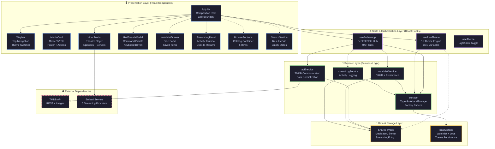

# Aether Stream Hub — Architecture Documentation

> **Version:** 1.0  
> **Last Updated:** 2024  
> **Status:** Active Development

---

## Table of Contents

1. [Architectural Overview](#architectural-overview)
2. [Layered Architecture](#layered-architecture)
3. [Data Flow](#data-flow)
4. [Core Modules](#core-modules)
5. [State Management](#state-management)
6. [Service Layer](#service-layer)
7. [Storage Abstraction](#storage-abstraction)
8. [Type System](#type-system)
9. [Component Patterns](#component-patterns)
10. [Security Architecture](#security-architecture)
11. [Performance Considerations](#performance-considerations)
12. [Testing Strategy](#testing-strategy)
13. [Deployment](#deployment)

---

## Architectural Overview

### High-Level Diagram



### Design Principles

| Principle | Description | Implementation |
|-----------|-------------|----------------|
| **Separation of Concerns** | UI, state, business logic, and storage are isolated | 4-layer architecture |
| **Single Responsibility** | Each module has one reason to change | Services, hooks, components |
| **Dependency Inversion** | High-level modules don't depend on low-level details | Service interfaces, storage abstraction |
| **Type Safety First** | End-to-end TypeScript with strict mode | Shared types, no `any` |
| **Encapsulation** | Internal state not exposed | Private module state, immutable exports |
| **Testability** | Pure functions, injectable dependencies | Vitest + jsdom + mocking |
| **Security by Default** | No secrets in code, env-based config | `.env.local`, no hardcoded keys |

---

## Layered Architecture

### Layer 1: Presentation (`src/components/`)

**Responsibility:** Pure UI rendering, event handling, accessibility

```typescript
// Components receive props, emit callbacks, manage no business logic
interface MediaCardProps {
  item: MediaItem;
  isInWatchlist: boolean;
  onClick: (item: MediaItem) => void;
  onToggleWatchlist?: (item: MediaItem) => void;
}
```

**Characteristics:**
- No direct API calls
- No localStorage access
- No business logic
- Full TypeScript props interfaces
- Accessibility built-in (ARIA, keyboard, focus)

### Layer 2: State & Orchestration (`src/hooks/`)

**Responsibility:** React state management, side-effect coordination, service integration

```typescript
// useAetherApp.ts — Single source of truth for app state
export function useAetherApp(): UseAetherAppReturn {
  // All state derived from services
  const [sections, setSections] = useState<HomeSections>(initialSections);
  const [watchlist, setWatchlist] = useState<MediaItem[]>(() => watchlistStorage.get());
  
  // Actions delegate to services
  const handleToggleItemWatchlist = useCallback((item: MediaItem) => {
    setWatchlist(prev => {
      const exists = prev.some(m => m.id === item.id);
      return exists ? prev.filter(m => m.id !== item.id) : [item, ...prev];
    });
  }, []);
}
```

**Hooks:**
| Hook | Responsibility |
|------|----------------|
| `useAetherApp` | Main app state, catalog, search, player, watchlist |
| `useRiceTheme` | 15-theme management, persistence, CSS variable injection |
| `useTheme` | Light/dark mode toggle |

### Layer 3: Service Layer (`src/lib/services.ts`)

**Responsibility:** Encapsulated business logic, API communication, data transformation

```typescript
// Pure functions, no React dependencies
export const apiService = {
  async fetchHomeSections(): Promise<HomeSections> { ... },
  async fetchSearchResults(filters: SearchFilters): Promise<MediaItem[]> { ... },
  async fetchItemDetails(item: MediaItem): Promise<ItemDetails> { ... },
  getStreamEmbedUrl(item: MediaItem, ...): string { ... },
};

export const watchlistService = {
  load(): MediaItem[] { return watchlistStorage.get(); },
  save(list: MediaItem[]): void { watchlistStorage.set(list); },
  add(item: MediaItem): void { ... },
  remove(mediaId: string): void { ... },
  toggle(item: MediaItem): boolean { ... },
};
```

**Services:**
| Service | Responsibility |
|---------|----------------|
| `apiService` | TMDB API communication, data normalization |
| `watchlistService` | Watchlist CRUD, persistence |
| `streamLogService` | Activity logging, persistence |

### Layer 4: Data & Storage (`src/lib/storage.ts`, `src/lib/types.ts`)

**Responsibility:** Type definitions, storage abstraction, external API contracts

```typescript
// Type-safe storage factory
export function createStorage<T>(key: string, options: StorageOptions<T>) {
  return {
    get(): T { ... },
    set(value: T): void { ... },
    remove(): void { ... },
  };
}

// Pre-configured instances
export const watchlistStorage = createStorage<MediaItem[]>(KEYS.WATCHLIST, { defaultValue: [] });
export const streamLogsStorage = createStorage<StreamLogEntry[]>(KEYS.STREAM_LOGS, { defaultValue: [] });
export const themeStorage = createStorage<string>(KEYS.THEME, { defaultValue: 'mocha' });
```

---

## Data Flow

### Initial Load Sequence

```
1. App.tsx mounts
   │
   ▼
2. useAetherApp initializes
   │
   ├── watchlistStorage.get() ───► localStorage
   ├── streamLogsStorage.get() ──► localStorage
   ├── themeStorage.get() ───────► localStorage → CSS variables
   │
   ▼
3. Parallel API calls
   │
   ├── apiService.fetchGenres() ──► TMDB /genre/movie/list + /genre/tv/list
   ├── apiService.fetchHomeSections() ──► 6 parallel TMDB calls
   │
   ▼
4. State hydration
   │
   ├── setGenres(genres)
   ├── setSections(sections)
   ├── setWatchlist(watchlist)
   ▼
5. UI renders with data
```

### User Interaction Flow (Search Example)

```
User types in RofiSearchModal
        │
        ▼
Debounced executeSearch(query)
        │
        ▼
apiService.fetchSearchResults({ query, genreId: '', type: 'all' })
        │
        ▼
TMDB API: /search/multi?query=...
        │
        ▼
normalizeItem() transforms raw response → MediaItem[]
        │
        ▼
setSearchResults(results)
        │
        ▼
SearchSection re-renders with MediaCard grid
        │
        ▼
User clicks MediaCard
        │
        ▼
onItemClick → handleLaunchMedia → openVideoModal
        │
        ▼
VideoModal mounts → apiService.fetchItemDetails() for rich metadata
```

### Watchlist Toggle Flow

```
MediaCard watchlist button clicked
        │
        ▼
handleWatchlistClick → handleToggleItemWatchlist(item)
        │
        ▼
setWatchlist(prev => exists ? filter : [item, ...prev])
        │
        ▼
useEffect([watchlist]) → watchlistService.save(watchlist)
        │
        ▼
watchlistStorage.set(watchlist) → localStorage
        │
        ▼
Stream log entry added via addStreamLog()
```

---

## Core Modules

### `src/App.tsx` — Application Root

```typescript
// Composition root: wires providers, error boundary, global state
function App() {
  const { theme: riceTheme, setTheme: setRiceTheme, themes: riceThemes } = useRiceTheme();
  const { /* all app state & actions */ } = useAetherApp();
  const [streamLogs, setStreamLogs] = useState(() => streamLogsStorage.get());

  return (
    <ErrorBoundary>
      <div className="min-h-screen bg-bg text-fg">
        <Waybar /* props */ />
        <main className="max-w-7xl mx-auto px-3 sm:px-6 pb-20">
          <ErrorBanner />
          <SearchSection /* conditional */ />
          <BrowseSections /* conditional */ />
        </main>
        <RofiSearchModal />
        <WatchlistDrawer />
        <StreamLogPanel />
        <VideoModal />
        <LoadingOverlay />
      </div>
    </ErrorBoundary>
  );
}
```

**Responsibilities:**
- Providers composition (currently none, but ready for Context)
- Error boundary wrapper
- Global state: stream logs, modals, drawers
- Action logging coordination

### `src/hooks/useAetherApp.ts` — Central State Hub

```typescript
// 400+ lines managing all app state
interface UseAetherAppReturn {
  // Catalog state
  sections: HomeSections;
  searchResults: MediaItem[];
  genres: Genre[];
  isLoading: boolean;
  errorMessage: string | null;

  // Player state
  isVideoModalOpen: boolean;
  currentMedia: MediaItem | null;
  activeServerIndex: number;
  currentSeason: number;
  currentEpisode: number;
  seasons: number;
  episodes: number;
  cast: CastMember[];
  tagline: string;
  duration: string;
  quality: string;

  // Actions (all delegate to services)
  handleSearch: (query?: string) => Promise<void>;
  handleServerChange: (index: number) => void;
  handleSeasonChange: (season: number) => void;
  handleEpisodeChange: (episode: number) => void;
  openVideoModal: (media: MediaItem | null) => Promise<void>;
  handleToggleItemWatchlist: (item: MediaItem) => void;
  // ... more actions
}
```

### `src/hooks/useRiceTheme.ts` — Theme Engine

```typescript
// 15 themes with CSS variable injection
export function useRiceTheme() {
  const [theme, setThemeState] = useState<ThemeId>(() => {
    return themeStorage.get() || 'mocha';
  });

  const setTheme = (newTheme: ThemeId) => {
    setThemeState(newTheme);
    document.documentElement.setAttribute('data-theme', newTheme);
    themeStorage.set(newTheme);
  };

  useEffect(() => {
    document.documentElement.setAttribute('data-theme', theme);
  }, [theme]);

  return { theme, setTheme, themes: THEMES };
}
```

---

## Service Layer

### `apiService` — TMDB Communication

```typescript
// Base URL and auth
const TMDB_BASE_URL = 'https://api.themoviedb.org/3';
const headers = {
  Authorization: `Bearer ${CONFIG.TMDB_READ_API_KEY}`,
  'Content-Type': 'application/json',
};

// Core methods
async fetchHomeSections(): Promise<HomeSections> {
  const [trending, popularMovies, popularTv, topRated, scifi, action] = await Promise.all([
    fetch('/trending/all/week'),
    fetch('/movie/popular'),
    fetch('/tv/popular'),
    fetch('/movie/top_rated'),
    fetch('/discover/movie', { with_genres: 878, sort_by: 'popularity.desc' }),
    fetch('/discover/movie', { with_genres: 28, sort_by: 'popularity.desc' }),
  ]);
  return { ...results.map(normalizeItem) };
}

async fetchSearchResults(filters: SearchFilters): Promise<MediaItem[]> {
  // Supports: direct TMDB ID, IMDb ID, genre auto-detection, text search
}

async fetchItemDetails(item: MediaItem): Promise<ItemDetails> {
  // Fetches /movie/:id or /tv/:id with append_to_response=credits
}

async fetchTvSeasonEpisodes(tvId: number, seasonNumber: number): Promise<Episode[]> {
  // Fetches /tv/:id/season/:seasonNumber
}

getStreamEmbedUrl(item, serverIndex, season, episode): string {
  // Constructs embed URLs for 5 streaming servers
}
```

### `watchlistService` — Persistence & CRUD

```typescript
// Delegates to storage abstraction
load(): MediaItem[] { return watchlistStorage.get(); }
save(list: MediaItem[]): void { watchlistStorage.set(list); }

add(item): void {
  const list = this.load();
  if (!list.some(m => m.id === item.id)) {
    list.unshift(item);
    this.save(list);
  }
}

remove(mediaId): void {
  this.save(this.load().filter(m => m.id !== mediaId));
}

toggle(item): boolean {
  const list = this.load();
  const exists = list.some(m => m.id === item.id);
  this.save(exists ? list.filter(m => m.id !== item.id) : [item, ...list]);
  return !exists;
}
```

### `streamLogService` — Activity Logging

```typescript
load(): StreamLogEntry[] { return streamLogsStorage.get(); }
save(logs): void { streamLogsStorage.set(logs); }

add(entry): StreamLogEntry {
  return {
    id: `${Date.now()}-${random}`,
    timestamp: new Date().toTimeString().split(' ')[0],
    ...entry,
  };
}
```

---

## Storage Abstraction

### Design Goals

1. **Type Safety** — Generic `createStorage<T>()` with compile-time guarantees
2. **Testability** — Mockable via `vi.stubGlobal('localStorage', mock)`
3. **Error Resilience** — Graceful degradation, console warnings
4. **Lazy Initialization** — Storage instances created on first access

### Implementation

```typescript
// Factory function
export function createStorage<T>(key: string, options: StorageOptions<T>) {
  const { defaultValue, serialize = JSON.stringify, deserialize = JSON.parse } = options;
  
  return {
    get(): T {
      try {
        const item = globalThis.localStorage.getItem(key);
        if (item === null) return defaultValue;
        return deserialize(item);
      } catch (e) {
        console.warn(`Failed to read ${key}:`, e);
        return defaultValue;
      }
    },
    set(value: T): void { ... },
    remove(): void { ... },
    clear(): void { ... },
  };
}

// Pre-configured instances (lazy)
const STORAGE_KEYS = {
  WATCHLIST: 'aether_saved_watchlist',
  STREAM_LOGS: 'aether-stream-logs',
  THEME: 'aether_theme',
  COLOR_SCHEME: 'aether-theme',
} as const;

let _watchlistStorage: ReturnType<typeof createStorage<MediaItem[]>> | null = null;
export const watchlistStorage = {
  get(): MediaItem[] { return (_watchlistStorage ??= createStorage(...)).get(); },
  set(v): void { return (_watchlistStorage ??= createStorage(...)).set(v); },
  // ...
};
```

---

## Type System

### Shared Types (`src/lib/types.ts`)

```typescript
// Core domain types
export interface MediaItem {
  id: string;           // "movie-550" or "tv-1399"
  tmdbId: number;       // TMDB internal ID
  type: 'movie' | 'tv';
  title: string;
  year: string;
  duration: string;
  rating: string;       // "8.8"
  genre: string;        // Primary genre
  genres: string[];     // All genres
  poster: string;       // TMDB image URL
  backdrop: string;     // TMDB backdrop URL
  overview: string;
}

export interface Server {
  id: string;
  name: string;
  getMovieUrl: (id: string) => string;
  getTvUrl: (id: string, s?: number, e?: number) => string;
}

export interface StreamLogEntry {
  id: string;
  timestamp: string;    // "HH:MM:SS"
  type: 'connect' | 'server' | 'watchlist' | 'episode';
  tag: string;          // "CONNECTED", "NODE_SWITCH", etc.
  message: string;
  media: MediaItem;
  serverIndex?: number;
  season?: number;
  episode?: number;
}

// API response types
export interface ItemDetails {
  tagline: string;
  duration: string;
  quality: string;
  cast: CastMember[];
  seasons: number;
  episodes: number;
  seasonsData: { season_number: number; episode_count: number }[];
}

export interface SearchFilters {
  query: string;
  genreId: string;
  type: 'all' | 'movie' | 'tv';
}

export interface HomeSections {
  trending: MediaItem[];
  popularMovies: MediaItem[];
  popularTv: MediaItem[];
  topRated: MediaItem[];
  scifi: MediaItem[];
  action: MediaItem[];
}
```

### Type Safety Practices

| Practice | Implementation |
|----------|----------------|
| **No `any`** | Strict TS config, eslint rules |
| **Consistent imports** | `import type { ... }` for types |
| **Discriminated unions** | `type: 'movie' | 'tv'` on `MediaItem` |
| **Generic factories** | `createStorage<T>()` with inference |
| **Strict null checks** | `strictNullChecks: true` in tsconfig |

---

## Component Patterns

### Pattern: Controlled Media Card

```tsx
// MediaCard.tsx — Pure presentational component
interface MediaCardProps {
  item: MediaItem;
  isInWatchlist: boolean;
  onClick: (item: MediaItem) => void;
  onToggleWatchlist?: (item: MediaItem) => void;
}

export function MediaCard({ item, isInWatchlist, onClick, onToggleWatchlist }) {
  // No business logic, only rendering + event forwarding
  return (
    <article onClick={handleClick} onKeyDown={handleKeyDown}>
      <PosterImage />
      <Badge type={item.type} />
      <WatchlistButton isActive={isInWatchlist} onClick={handleWatchlistClick} />
      <PlayOverlay />
      <Metadata title={item.title} year={item.year} genre={item.genre} rating={item.rating} />
    </article>
  );
}
```

### Pattern: Service-Integrated Hook

```tsx
// useAetherApp.ts — State + service delegation
export function useAetherApp() {
  const [watchlist, setWatchlist] = useState(() => watchlistStorage.get());

  const handleToggleItemWatchlist = useCallback((item: MediaItem) => {
    setWatchlist(prev => {
      const exists = prev.some(m => m.id === item.id);
      return exists ? prev.filter(m => m.id !== item.id) : [item, ...prev];
    });
  }, []);

  // Sync to storage
  useEffect(() => {
    watchlistStorage.set(watchlist);
  }, [watchlist]);
}
```

### Pattern: Accessible Modal

```tsx
// VideoModal.tsx — Focus trap, keyboard nav, ARIA
export function VideoModal({ isOpen, onClose, ... }) {
  if (!isOpen) return null;

  return (
    <div role="dialog" aria-modal="true" aria-labelledby="modal-title">
      <div className="modal-overlay" onClick={onClose} />
      <div className="modal-content" onClick={e => e.stopPropagation()}>
        <Header title={media.title} onClose={onClose} />
        <VideoPlayer src={streamUrl} />
        <EpisodeSidebar />
      </div>
    </div>
  );
}
```

---

## Security Architecture

### Threat Model

| Threat | Mitigation |
|--------|------------|
| **API Key Exposure** | Env-only config, no hardcoded keys, `.gitignore` for `.env.local` |
| **XSS via TMDB Data** | `escapeHtml()` utility, React auto-escaping, `dangerouslySetInnerHTML` avoided |
| **Clickjacking** | `X-Frame-Options: DENY`, CSP `frame-ancestors 'none'` |
| **Mixed Content** | All embeds HTTPS, CSP `upgrade-insecure-requests` |
| **Data Injection** | Input validation, `createStorage` deserialization guards |

### Configuration Security

```typescript
// src/lib/config.ts — Zero secrets in source
const envKey = import.meta.env?.VITE_TMDB_READ_API_KEY || '';
const activeTmdbKey = envKey && envKey !== 'your_tmdb_read_access_token_here' ? envKey : '';

if (!activeTmdbKey) {
  console.warn('[Aether] VITE_TMDB_READ_API_KEY not configured');
}

export const CONFIG = {
  TMDB_READ_API_KEY: activeTmdbKey,  // Empty string if not set
  // ... other non-sensitive config
};
```

### Content Security Policy (Recommended)

```http
Content-Security-Policy:
  default-src 'self';
  script-src 'self' 'unsafe-inline';
  style-src 'self' 'unsafe-inline';
  img-src 'self' data: https://image.tmdb.org https://*.vidlink.pro https://*.vidsrc.pm https://*.vidsrc.su https://autoembed.co https://www.2embed.cc;
  frame-src https://*.vidlink.pro https://*.vidsrc.pm https://*.vidsrc.su https://autoembed.co https://www.2embed.cc;
  connect-src 'self' https://api.themoviedb.org;
  font-src 'self' data:;
  base-uri 'self';
  form-action 'self';
  frame-ancestors 'none';
```

---

## Performance Considerations

### Bundle Optimization

| Technique | Implementation |
|-----------|----------------|
| **Code Splitting** | Vite automatic, dynamic imports for modals |
| **Tree Shaking** | ES modules, sideEffects: false in package.json |
| **CSS Purging** | Tailwind `content` paths, unused styles removed |
| **Asset Optimization** | Vite image optimization, SVG inlining |

### Runtime Performance

| Concern | Solution |
|---------|----------|
| **Large Lists** | Horizontal virtual scrolling via CSS snap, grid virtualization not needed |
| **Image Loading** | `loading="lazy"`, `object-cover`, responsive sizes via TMDB |
| **Re-renders** | `React.memo` on `MediaCard`, `useCallback` on all handlers |
| **Debouncing** | 250ms search debounce in `RofiSearchModal` |
| **Memoization** | `useMemo` for derived state (filtered lists, computed values) |

### Network Optimization

| Strategy | Implementation |
|---------|----------------|
| **Parallel Requests** | `Promise.all` for home sections (6 concurrent) |
| **Caching** | TMDB responses not cached (fresh data priority), watchlist/logs in localStorage |
| **Embed Performance** | 5 pre-configured streaming servers, instant switch |
| **Prefetching** | None currently — could add on hover |

---

## Testing Strategy

### Test Pyramid

```
         ▲
        / \     E2E Tests (Playwright - future)
       /   \
      /─────\   Integration Tests (component + service)
     /       \
    /─────────\ Unit Tests (pure functions, types)
   /___________\
```

### Current Coverage

| Layer | Tool | Coverage |
|-------|------|----------|
| **Types** | `tsc --noEmit` | 100% compile-time |
| **Storage Utils** | Vitest | 15 tests passing |
| **Service Layer** | Vitest | Planned |
| **Components** | Vitest + RTL | Planned |
| **E2E** | Playwright | Future |

### Test Utilities

```typescript
// src/test/setup.ts — Shared test infrastructure
vi.stubGlobal('localStorage', mockLocalStorage);
Object.defineProperty(window, 'matchMedia', { ... });
document.createElement = vi.fn((tagName) => ...);
global.fetch = vi.fn();
```

---

## Deployment

### Build Pipeline

```bash
# CI/CD Steps
npm ci                    # Clean install
npm run lint              # ESLint (fail on warnings)
npm run format:check      # Prettier (fail on diff)
npm run build             # tsc + vite build
npm run test              # Vitest (fail on fail)
```

### Output

```
dist/
├── index.html           # 0.74 KB (gzip: 0.41 KB)
├── assets/
│   ├── index-[hash].css # 28-30 KB (gzip: ~6.5 KB)
│   └── index-[hash].js  # 211-217 KB (gzip: ~64 KB)
```

### Hosting Requirements

| Requirement | Value |
|-------------|-------|
| **Static Hosting** | Netlify, Vercel, Cloudflare Pages, GitHub Pages |
| **SPA Routing** | Fallback to `index.html` for all paths |
| **HTTPS** | Required (TMDB API, embed origins) |
| **Headers** | CSP, HSTS, X-Frame-Options recommended |
| **Compression** | Brotli/Gzip for JS/CSS |

### Environment Variables

```bash
# Production
VITE_TMDB_READ_API_KEY=production_token
VITE_BACKEND_URL=https://api.yourdomain.com
VITE_HOSTNAME=yourdomain.com

# Preview/Staging
VITE_TMDB_READ_API_KEY=staging_token
VITE_BACKEND_URL=https://staging-api.yourdomain.com
VITE_HOSTNAME=staging.yourdomain.com
```

---

## Appendix: File Reference

### Configuration Files

| File | Purpose |
|------|---------|
| `vite.config.ts` | Vite + React plugin, port 3000 |
| `tailwind.config.js` | Theme tokens, 15 rice themes, custom utilities |
| `tsconfig.json` | Strict TypeScript, path aliases (`@/*`) |
| `.eslintrc.cjs` | ESLint + TypeScript ESLint + Prettier |
| `.prettierrc` | Single quotes, 2-space, trailing commas |
| `vitest.config.ts` | jsdom, globals, setup file |

### Key Source Files

| File | Lines | Purpose |
|------|-------|---------|
| `src/App.tsx` | ~290 | Root component, provider composition |
| `src/hooks/useAetherApp.ts` | ~390 | Central state hub |
| `src/hooks/useRiceTheme.ts` | ~80 | Theme engine |
| `src/lib/services.ts` | ~460 | Business logic layer |
| `src/lib/storage.ts` | ~90 | Storage abstraction |
| `src/lib/types.ts` | ~60 | Shared type definitions |
| `src/lib/config.ts` | ~100 | Environment configuration |
| `src/components/MediaCard.tsx` | ~120 | Movie/TV card |
| `src/components/VideoModal.tsx` | ~460 | Player modal |
| `src/components/RofiSearchModal.tsx` | ~330 | Command palette |
| `src/components/Waybar.tsx` | ~190 | Top navigation |
| `src/index.css` | ~380 | Global styles, 15 themes |

---

*Document generated from source code analysis. Update when architecture evolves.*